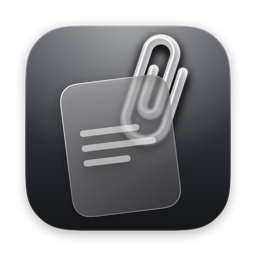
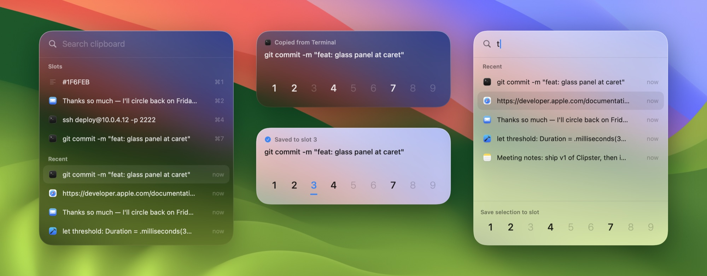

<p align="center">
  
</p>

<h1 align="center">Clipster</h1>

<p align="center">
  A fast, native clipboard manager for macOS, with nine slots and a Liquid Glass panel that opens right at your cursor.
</p>

<p align="center">
  
  <br>
  <sub>Left: hold ⌘V to paste from slots and history. Middle: hold ⌘C to save what you just copied to a slot. Right: search.</sub>
</p>

## Why Clipster

- **No new shortcuts to learn.** Tap ⌘C and ⌘V as usual. Hold them to open Clipster.
- **Nine slots** for the things you paste all the time, like your email address, a hex color or an SSH command. Hold ⌘V and press a number.
- **Opens at your text cursor**, not in the middle of the screen. The app you're typing in keeps focus the whole time.
- **Fast.** Native Swift and AppKit, with no web view. The panel is built once at launch, so showing it is just moving it into place.
- **Private by default.** Everything stays on your Mac. Items that password managers mark as concealed are never recorded.

## How it works

| Do this | What happens |
| --- | --- |
| Tap **⌘C** / **⌘V** | Normal copy / paste, untouched |
| **Hold ⌘C** | A small card shows what you just copied. Keep ⌘ held and press **1–9** to save it to that slot, then let go |
| **Hold ⌘V** | The panel opens with your slots and recent history. Keep ⌘ held and press **1–9** to paste that slot instantly, or tap **V** again to step through history and let go of ⌘ to paste the selected item (like ⌘Tab) |
| Hold, then let go of ⌘ without picking anything | The panel stays open. Type to search, use **↑ ↓** and **↩** to paste, **⌘1–9** for slots, **⇥** to switch between Save and Paste, **⌘⌫** to delete, **esc** to close |

You can also use the mouse: click a row to paste it, click a slot number to save to it, and right-click to clear or delete.

## Install

Requires **macOS 26 (Tahoe)** and the Xcode Command Line Tools (`xcode-select --install`).

```sh
git clone https://github.com/TejasBaid/clipster.git
cd clipster
make install    # builds Clipster.app, copies it to /Applications, and launches it
```

On first launch, macOS asks for **Accessibility** access (System Settings → Privacy & Security → Accessibility). Clipster needs it to detect ⌘C/⌘V being held and to paste into other apps. The hotkeys start working as soon as you grant access, without a relaunch.

Clipster lives in the menu bar (📎). From there you can open the panel, turn on **Open at Login**, or clear your history and slots.

> **Tip:** `scripts/bundle.sh` signs the app with your Apple Development certificate if you have one. Then macOS remembers the Accessibility grant across rebuilds. With ad-hoc signing, you'll need to grant it again after every build.

## Development

```sh
make run       # build build/Clipster.app and launch it
make test      # unit tests: gesture state machine and store
make preview   # show the panel with sample data (in memory, nothing saved)
make icon      # re-render the app icon from scripts/make-icon.swift
```

To try another icon color, run `ICON_PALETTE=midnight make icon`. The options are `graphite` (the default), `midnight`, `ocean` and `indigo`.

History (the last 300 items) and slots are saved to `~/Library/Application Support/Clipster/store.json`.

### Project layout

```
Sources/
  ClipsterCore/          Pure logic, no AppKit, unit tested
    HotkeyMachine.swift    Tap-vs-hold gesture state machine for ⌘C / ⌘V
    ClipStore.swift        History, slots, persistence
  Clipster/              The app
    EventTap.swift         CGEventTap → HotkeyMachine events
    Coordinator.swift      Wires gestures, store and panel together
    PanelController.swift  Non-activating NSGlassEffectView panel, positioned at the caret
    PanelView.swift        SwiftUI UI
    CaretLocator.swift     Finds the text cursor via the Accessibility API
    PasteboardWatcher.swift, Paster.swift
scripts/                 App bundling and icon rendering
```

The interesting part is `HotkeyMachine`. A tap of ⌘C goes straight through to the app. A tap of ⌘V is held back for a moment and then replayed, so that holding it never pastes twice. A press counts as a hold after 350 ms. The machine is a pure value type, so every gesture rule is covered by tests in `Tests/ClipsterCoreTests`.

## Roadmap

- Put your clipboard back after pasting from a slot
- Images, files and rich text
- Paste as plain text, plus quick transforms (change case, trim, JSON/URL encode)
- Settings for the hold delay, history size and apps to ignore
